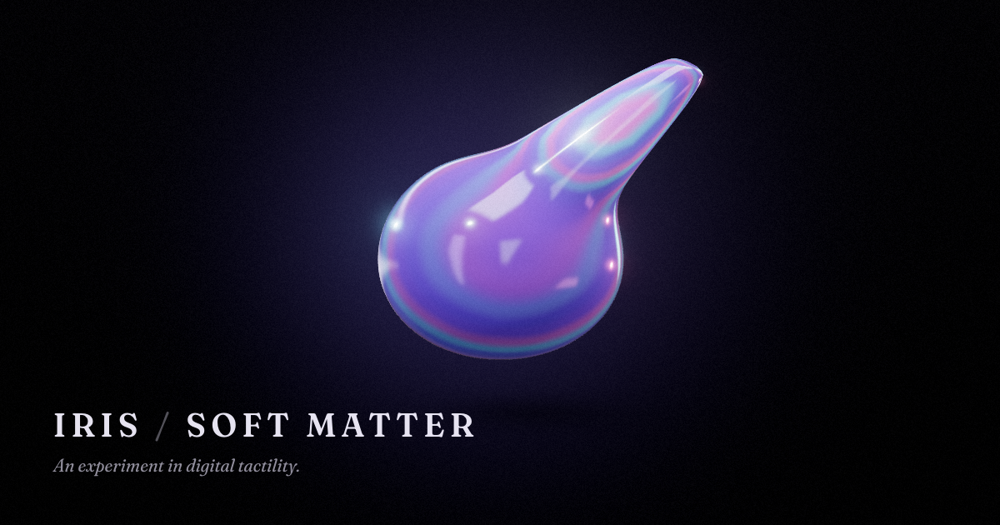

# IRIS / SOFT MATTER

*An experiment in digital tactility.*

One blob of holographic digital slime, floating in a quiet studio. Grab it and pull — a glob
draws out on a stretchy neck. Let go and it sags home with a lazy wobble. Press in and it dents;
the rest of the body bulges to keep its volume. That's the whole thing: a single piece of soft
matter that feels good to touch.



**Live:** https://mariaareadne1.github.io/iris-soft-matter/

## Play

| Do | What happens |
|---|---|
| Drag the blob | The touched region is pinched and pulled; the body stretches, then follows lazily |
| Release | The stretch sags back with viscous recovery and a little overshoot |
| Click / tap | A poke — a dent that springs back and wobbles |
| Press and hold | A squish that deepens while held |
| Drag empty space | Orbit the camera · scroll to zoom |
| `R` / `H` / `D` / `Esc` | Reset · clean view · show demo · close panel |

**Materials:** Holographic Jelly (default), Liquid Chrome, Pastel Putty, Clear Slime — all on the
same blob, each with its own optics *and* physics.

**Customize (Studio):** material, color, Stretchiness, Viscosity, Softness, Wobble, Recovery
speed, Iridescence, Gloss, Background. Every control drives the simulation or the renderer
directly (the E2E suite checks each one).

**Capture:** PNG still (rendered at ≥3× resolution), an 8-second clip, or *Record demo* — which
plays the scripted showcase through the real physics while recording. Controls hide while
recording, and `H` gives a clean view for screen-recording tools.

## How the slime works

`src/sim/softBody.ts` is a dependency-free volumetric soft body, stepped at a fixed 120 Hz
(frame-rate independent, deterministic):

- **Surface particles** — a 2,562-vertex icosphere settled into a slightly squashed drop.
- **Small-step XPBD edges** (Macklin et al. 2019) — compliant distance constraints, so the skin
  can stretch. Their rest lengths *flow* toward the current length while stretched and creep
  back afterwards: a Maxwell-style viscoelastic skin, so a released stretch sags instead of snapping.
- **Global volume constraint** — the closed mesh's signed volume is held constant, so dents bulge
  out elsewhere and stretched necks thin out.
- **Anchored shape matching** (Müller et al. 2005, rotation via Müller 2016) — pulls toward the
  resting form, split into an *elastic* share (builds velocity → wobble, capped by a yield
  distance) and a *viscous* share (moves position and history together → slow creep).
  The resting frame stays mostly anchored, so pulling stretches the blob instead of dragging it.
- **Laplacian surface tension** — keeps the skin smooth and rounds tendrils.
- **Soft-selection grab** — a pointer press sinks a peaked, wide bowl; once you drag, the grip
  morphs into a pinch with a held core, so pulls form a rounded glob on a neck. Pulls are softly
  limited, and the body self-heals if it ever goes non-finite (it never has in testing).

Rendering (`src/render/`) refines each simulated triangle into four on the curved PN-triangle
patch (20,480 triangles on screen), and a `MeshPhysicalMaterial` with transmission, clearcoat and
thin-film iridescence gets an injected holographic film layer — adapted from the Iris cloth foil
shader — whose hue flows with view angle and **local strain**: stretched skin flares brighter,
like a thinning soap film. A small HDR "photo studio" baked to a PMREM supplies the lavender,
cyan and pink highlights.

## Run locally

Needs Node 20+.

```bash
npm install
npm run dev        # http://localhost:5299
```

```bash
npm run build      # type-check + production build into dist/
npm run preview    # serve dist/ on http://localhost:4173
```

## Tests

```bash
npm test                         # 22 deterministic physics tests (Vitest, Node)
npx playwright install chromium  # once
npm run test:e2e                 # 16 browser tests against the production build
```

The physics tests check topology, rest stability, stretch locality, volume preservation, gradual
release, poke recovery, 120 random grabs, extreme settings, frame-rate independence, determinism,
and that every behavior slider has a measurable effect. The browser tests drive real mouse and
touch input and assert on simulation metrics **and pixel differences** — a passing test means the
blob visibly changed shape, not just that a handler fired. They cover presets, Studio wiring,
PNG and video export (the video is decoded in the browser), the demo, embed mode in a resizable
iframe and a Pixel 7 mobile viewport.

Visual review helpers: `node scripts/shots.mjs <url> <outDir>` saves rest / stretch / side /
press screenshots for every preset; `scripts/og.mjs` regenerates the social image.

## Deploy

It's a static site — `dist/` can go anywhere. The build uses relative asset paths, so it also
works from a sub-folder.

- **GitHub Pages (set up):** `.github/workflows/deploy.yml` tests, builds and publishes on every
  push to `main`.
- **Vercel / Netlify:** framework "Vite", build command `npm run build`, output `dist`.

If you deploy somewhere other than GitHub Pages, update the absolute `og:image`, `og:url` and
`twitter:image` URLs in `index.html`.

## Embed in a portfolio

```html
<iframe
  src="https://mariaareadne1.github.io/iris-soft-matter/?embed=1"
  title="IRIS / SOFT MATTER — interactive slime"
  style="width:100%;aspect-ratio:16/10;border:0;border-radius:16px"
  loading="lazy"
  allow="fullscreen"
></iframe>
```

| Parameter | Effect |
|---|---|
| `embed=1` | Hide the wordmark, play bar and Studio; keep the canvas and a fading hint |
| `controls=1` | With `embed=1`, keep the play bar (materials, reset, capture) |
| `material=jelly\|chrome\|putty\|clear` | Starting material |
| `bg=nocturne\|porcelain\|dusk\|void` | Starting background |
| `fixedres=1` | Turn off adaptive resolution (by default it lowers render resolution on slow GPUs and restores it when there's headroom) |

The canvas tracks its container with a `ResizeObserver`, so any iframe size works. Touch input
is captured inside the frame (`touch-action: none`), so drags won't scroll the host page.

## Video format and MP4 conversion

Clips are recorded from the canvas with `MediaRecorder`. The app asks the browser for MP4
(H.264) first and falls back to WebM (VP9/VP8), and the file extension always matches what was
actually recorded. Safari and recent Chrome produce `.mp4`; Firefox produces `.webm`.

X accepts MP4. To convert a WebM clip:

```bash
ffmpeg -i iris-soft-matter-clip.webm -c:v libx264 -pix_fmt yuv420p -crf 18 -preset slow -movflags +faststart iris-soft-matter-clip.mp4
```

## Project layout

```
src/sim/       soft body, icosphere topology, behavior → coefficients, rotation extraction
src/render/    PN-refined geometry, slime material, stage (env, backdrop, shadow, post), presets
src/engine/    SlimeApp (loop + public API), pointer interaction, demo player, capture
src/ui/        React UI: play bar, Studio panel, settings / URL options, styles
tests/unit/    Vitest physics tests        tests/e2e/   Playwright browser tests
```

## Credits

**IRIS / SOFT MATTER** by [Maria Showalter](https://github.com/Mariaareadne1) is a new soft-matter
exploration growing out of **[Iris](https://github.com/Mariaareadne1/iris-cloth)**, her holographic
cloth toy, which is itself an adaptation of the excellent open-source
**[Holocloth](https://github.com/dmitrykurash/holocloth)** by [Dmitry Kurash](https://x.com/DmitryKurash).
The holographic film shader, film-grain pass and overall scene structure descend from that work
and are used under the MIT License (see [LICENSE](LICENSE)).

- [Three.js](https://threejs.org), [React](https://react.dev), [Vite](https://vite.dev)
- [Fraunces](https://github.com/undercasetype/Fraunces) typeface by Undercase Type (SIL Open Font License)
- Methods: Macklin, Müller & Chentanez, *Small Steps in Physics Simulation* (2019);
  Müller et al., *Meshless Deformations Based on Shape Matching* (2005);
  Müller et al., *A Robust Method to Extract the Rotational Part of Deformations* (2016);
  Vlachos et al., *Curved PN Triangles* (2001)
